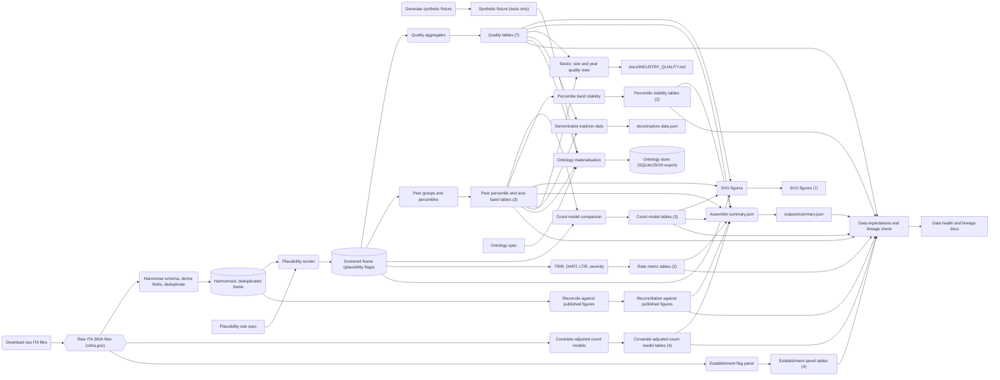

# Pipeline lineage

Generated by `python3 -m ehs_osha.health` from `src/ehs_osha/health/lineage.json`. Do not edit by hand: `tests/test_health.py` fails if this file differs from the generator output. The same command validates that every declared path exists, every producing function is defined, and every committed table is placed in the graph.

18 stages, 20 artifacts. Rounded boxes are stages, rectangles are committed files, cylinders are in-memory frames, and the hexagon is the external source.

## Stages

| Stage | Producer | Reads | Writes |
|---|---|---|---|
| Download raw ITA files | `ehs_osha/download.download_all` | none | Raw ITA 300A files (osha.gov) |
| Generate synthetic fixture | `synthetic/generate_fixture.py:main` | none | Synthetic fixture (tests only) |
| Harmonise schema, derive fields, deduplicate | `ehs_osha/load.load_ita_300a` | Raw ITA 300A files (osha.gov) | Harmonised, deduplicated frame |
| Plausibility screen | `ehs_osha/quality.apply_screen` | Harmonised, deduplicated frame, Plausibility rule spec | Screened frame (plausibility flags) |
| Quality aggregates | `ehs_osha/pipeline.stage_quality` | Screened frame (plausibility flags) | Quality tables (7) |
| Peer groups and percentiles | `ehs_osha/pipeline.stage_peers` | Screened frame (plausibility flags) | Peer percentile and size-band tables (3) |
| Count model comparison | `ehs_osha/pipeline.stage_count_models` | Screened frame (plausibility flags), Peer percentile and size-band tables (3) | Count model tables (3) |
| Percentile band stability | `ehs_osha/pipeline.stage_stability` | Peer percentile and size-band tables (3) | Percentile stability tables (2) |
| TRIR, DART, LTIR, severity | `ehs_osha/pipeline.stage_metrics` | Screened frame (plausibility flags) | Rate metric tables (2) |
| Covariate-adjusted count models | `ehs_osha/pipeline.stage_count_models_covariates` | Raw ITA 300A files (osha.gov) | Covariate-adjusted count model tables (4) |
| Reconcile against published figures | `ehs_osha/pipeline.stage_reconcile` | Harmonised, deduplicated frame | Reconciliation against published figures |
| Establishment flag panel | `ehs_osha/panel.run` | Raw ITA 300A files (osha.gov) | Establishment panel tables (4) |
| SVG figures | `ehs_osha/pipeline.make_figures` | Screened frame (plausibility flags), Quality tables (7), Peer percentile and size-band tables (3), Count model tables (3) | SVG figures (7) |
| Assemble summary.json | `ehs_osha/pipeline.run_pipeline` | Quality tables (7), Peer percentile and size-band tables (3), Count model tables (3), Percentile stability tables (2), Rate metric tables (2), Covariate-adjusted count model tables (4), Reconciliation against published figures | outputs/summary.json |
| Sector, size and year quality view | `ehs_osha/industry_quality.main` | Quality tables (7), Peer percentile and size-band tables (3) | docs/INDUSTRY_QUALITY.md |
| Denominator explorer data | `scripts/build_explore_data.py:main` | Quality tables (7), Peer percentile and size-band tables (3) | docs/explore-data.json |
| Ontology materialisation | `ehs_osha/ontology/materialise.build_store` | Synthetic fixture (tests only), Quality tables (7), Peer percentile and size-band tables (3), Ontology spec | Ontology store (SQLite/JSON export) |
| Data expectations and lineage check | `ehs_osha/health/expectations.run_expectations` | Quality tables (7), Peer percentile and size-band tables (3), Count model tables (3), Percentile stability tables (2), Rate metric tables (2), Covariate-adjusted count model tables (4), Reconciliation against published figures, Establishment panel tables (4), outputs/summary.json | Data health and lineage docs |

## Artifacts

| Artifact | Kind | Produced by | Paths |
|---|---|---|---|
| Raw ITA 300A files (osha.gov) | external | download | `data/raw` |
| Synthetic fixture (tests only) | file | fixture_generate | `synthetic/fixture/GROUND_TRUTH.json` `synthetic/fixture/SYNTHETIC_ITA_300A_2021.csv` |
| Harmonised, deduplicated frame | memory | load | in memory |
| Screened frame (plausibility flags) | memory | screen | in memory |
| Quality tables (7) | file | quality | `outputs/tables/quality_overall.csv` `outputs/tables/quality_by_year.csv` `outputs/tables/quality_by_naics2.csv` `outputs/tables/quality_flag_prevalence.csv` `outputs/tables/quality_sensitivity_grid.csv` `outputs/tables/quality_hours_concentration.csv` `outputs/tables/quality_top50_implausible_hours.csv` |
| Peer percentile and size-band tables (3) | file | peers | `outputs/tables/peer_percentiles_by_year.csv` `outputs/tables/peer_percentiles_pooled.csv` `outputs/tables/size_band_effects.csv` |
| Count model tables (3) | file | count_models | `outputs/tables/count_model_comparison.csv` `outputs/tables/count_model_fit_detail.csv` `outputs/tables/count_model_selection_summary.csv` |
| Percentile stability tables (2) | file | stability | `outputs/tables/percentile_band_stability.csv` `outputs/tables/peer_group_persistence.csv` |
| Rate metric tables (2) | file | metrics | `outputs/tables/metrics_by_year.csv` `outputs/tables/metrics_pooled.csv` |
| Covariate-adjusted count model tables (4) | file | covariate_models | `outputs/tables/count_model_covariates.csv` `outputs/tables/count_model_covariates_summary.csv` `outputs/tables/count_model_covariates_fit_detail.csv` `outputs/tables/count_model_covariates_coverage.csv` |
| Reconciliation against published figures | file | reconcile | `outputs/tables/reconciliation_panels.csv` |
| Establishment panel tables (4) | file | panel | `outputs/tables/panel_coverage.csv` `outputs/tables/panel_transitions.csv` `outputs/tables/panel_permutation.csv` `outputs/tables/panel_2019.csv` |
| SVG figures (7) | file | figures | `outputs/figures/fig01_aggregate_trir_by_year.svg` `outputs/figures/fig02_hours_share_implausible.svg` `outputs/figures/fig03_hours_per_employee.svg` `outputs/figures/fig04_count_model_fit.svg` `outputs/figures/fig05_zero_share_by_size.svg` `outputs/figures/fig06_percentile_stability.svg` `outputs/figures/fig08_panel_persistence.svg` |
| outputs/summary.json | file | summary | `outputs/summary.json` |
| Plausibility rule spec | file | none (source) | `src/ehs_osha/plausibility_rules.json` |
| docs/INDUSTRY_QUALITY.md | file | industry_quality | `docs/INDUSTRY_QUALITY.md` |
| docs/explore-data.json | file | explore_data | `docs/explore-data.json` |
| Ontology spec | file | none (source) | `src/ehs_osha/ontology/spec.json` `docs/ontology.md` |
| Ontology store (SQLite/JSON export) | memory | ontology | in memory |
| Data health and lineage docs | file | health | `docs/DATA_HEALTH.md` `docs/LINEAGE.md` |
