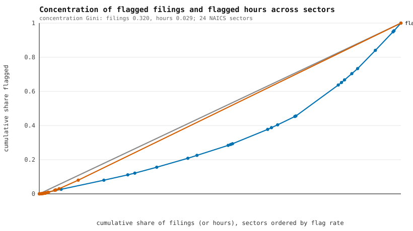

# How concentrated are implausible filings across NAICS sectors?

Generated by `scripts/build_flag_concentration.py` from committed tables. Do not edit by hand: `tests/test_flag_concentration.py` fails if this page, the CSVs or the chart differ from the script output.

## Choice of analysis

`docs/INDUSTRY_QUALITY.md` ranks sectors by flag rate with Wilson intervals, `docs/YEAR_STABILITY.md` leaves years out, and `docs/THRESHOLD_ROBUSTNESS.md` varies the bounds. None of them measures how unevenly the flagged filings and flagged hours are spread across sectors with a single summary. This page adds that: Lorenz-type concentration curves, a concentration Gini, top-k shares and exact intervals, using only `quality_by_naics2.csv` and `quality_overall.csv`.

## Method

- Rows: the 24 two-digit NAICS sector rows with at least 1,000 filings; code 99 (not a sector) and small codes are excluded. They hold 2,798,839 filings, of which 57,490 are flagged.
- Concentration curve: sectors are sorted by flag rate from lowest to highest; x is the cumulative share of filings, y the cumulative share of flagged filings. The concentration Gini is 1 - 2 x (area under the curve), computed by the trapezoid rule. 0 means every sector holds flagged filings in proportion to its filings; values near 1 mean a few sectors hold nearly all of them.
- Flagged hours: per sector, `hours_total x hours_share_implausible`. The same curve and Gini are computed with hours as the weight, sectors ordered by flagged-hours share.
- Intervals: the Gini interval is the 2.5th to 97.5th percentile of 2000 parametric bootstrap draws (flagged count ~ Binomial(sector filings, observed sector rate), seed 20261105). Per-sector flag rates and the top-5 flagged share carry exact Clopper-Pearson 95% intervals (bisection on the binomial cdf, no SciPy).

## Results

1. **Filings.** The concentration Gini of flagged filings is **0.320** (bootstrap 95% interval 0.316 to 0.324). The 5 sectors with the highest flag rates hold 13.57% of filings but 29.60% of flagged filings (exact 95% interval 29.23% to 29.97%).
2. **Hours.** Flagged filings carry 96.7% of all reported hours, so the hours curve sits almost on the equality line and its concentration Gini (0.029) is near zero. That low value is not evenness: it only says flagged hours track total hours. The absolute concentration is extreme. NAICS 23 (Construction) holds 92.0% of flagged hours alone, and the top three sectors hold 98.1%.
3. **Count leaders.** The three sectors with the most flagged filings hold 39.7% of them against 21.5% of filings. Herfindahl index of flagged filings: 0.0830; of flagged hours: 0.8490 (an even split over 24 sectors would give 0.0417).

### Sectors with the most flagged filings

| Rank | NAICS | Sector | Flagged | % of flagged | % of filings | Flag rate (exact 95% CI) | % of flagged hours |
|---|---|---|---|---|---|---|---|
| 1 | 62 | Health care and social assistance | 10,422 | 18.1% | 11.7% | 3.18% (3.12% to 3.24%) | 1.1% |
| 2 | 56 | Administrative and support and waste management | 6,242 | 10.9% | 4.9% | 4.57% (4.46% to 4.68%) | 0.1% |
| 3 | 72 | Accommodation and food services | 6,143 | 10.7% | 4.9% | 4.47% (4.36% to 4.58%) | 0.1% |
| 4 | 23 | Construction | 4,834 | 8.4% | 9.7% | 1.78% (1.73% to 1.83%) | 92.0% |
| 5 | 42 | Wholesale trade | 3,366 | 5.9% | 8.6% | 1.39% (1.35% to 1.44%) | 0.1% |
| 6 | 44 | Retail trade (44) | 3,067 | 5.3% | 11.8% | 0.93% (0.90% to 0.96%) | 0.7% |

The full per-sector table is `outputs/flag_concentration_sectors.csv`; the curve points are in `outputs/flag_concentration_lorenz.csv`.

## Limitations

- Sampling intervals describe binomial noise given the filings that exist; they say nothing about measurement error in the filings or about which flag rule fired (the committed tables do not give per-flag counts by sector).
- Flagged hours are reconstructed as `hours_total x hours_share_implausible`, both committed and rounded to float precision. No interval is given for the hours Gini because a few single filings dominate hours and a binomial model does not describe that.
- Gini and top-k shares depend on how sectors are partitioned. Manufacturing, retail and transportation are each split across several two-digit codes in the source table, and this page keeps them split, which lowers measured concentration relative to a merged partition.
- The top-5 sectors are chosen from the same data they are measured on, so the interval on their share is conditional on that selection and is narrower than a fully honest selection-adjusted one.
- Exclusions (code 99 and codes under 1,000 filings) are a choice. Code 99 has the highest flag rate but is not a sector.
- Concentration here is across sectors only; it says nothing about concentration across establishments or companies within a sector.
